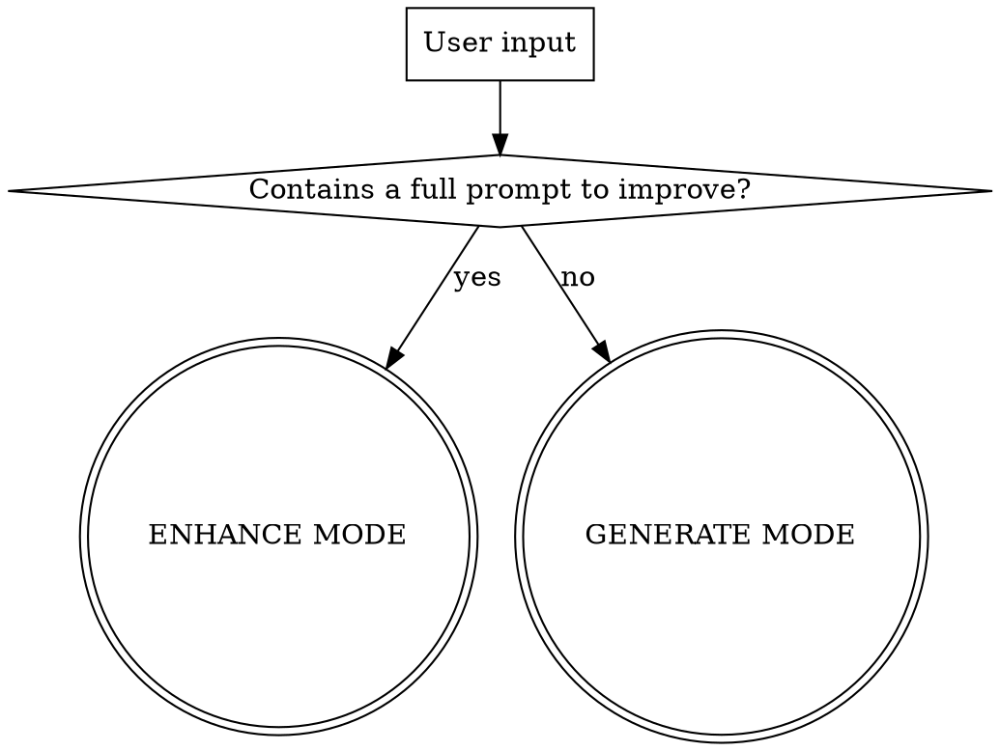
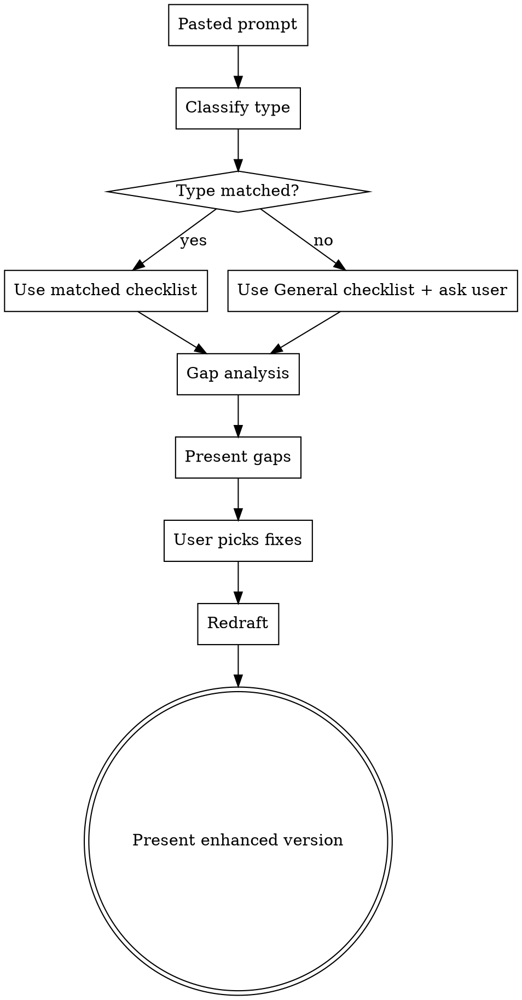

# Prompt Generator

General-purpose prompt engine that generates finished, executable prompts of any type and length. Adapts research depth to complexity, applies established prompting frameworks, enforces type-specific quality checklists, and embeds relevant skill invocations into every prompt.

## Two Entry Modes

Detect which mode based on user input:
- **Generate mode**: User describes what they want prompted
- **Enhance mode**: User pastes an existing prompt to improve



---

## GENERATE MODE

### Phase 1: Search Templates & History

Before generating anything, search for existing prompts:

```
.claude/skills/prompt-generator/templates/   <- Type-specific templates
.claude/skills/prompt-generator/history/     <- Saved past prompts
```

**If a good match exists:** Adapt it and skip to Phase 3 (Draft).
**If partial match (related but not exact):** Use as scaffold, layer on missing checklist items, run Medium-tier research.
**If no match:** Continue to classification.

### Phase 2: Classify

Detect **type** and **complexity tier** from the user's request.

**Prompt Types:**

| Type | Signals |
|------|---------|
| Implementation | "build", "implement", "add", "fix", "refactor" |
| Architecture | "design", "architect", "data model", "system design" |
| Research | "research", "investigate", "compare", "evaluate" |
| Audit | "audit", "review", "assess", "compliance" |
| PRD/Spec | "PRD", "spec", "requirements", "user stories" |
| Testing | "write tests", "test strategy", "QA", "coverage" |
| Creative/Brainstorming | "brainstorm", "ideate", "explore options" |
| Cross-Codebase Handoff | "handover to backend", "backend prompt", "cross-team" |
| General | Doesn't fit above categories |

**Complexity Tiers:**

| Tier | Signals | Research Level |
|------|---------|---------------|
| Light | Short, single-focus, well-defined, user says "keep it simple" | None — checklist only |
| Medium | Moderate scope, needs codebase context, some domain knowledge | Codebase search |
| Heavy | Multi-concern, novel domain, architecture-level, user says "go deep" | Orchestrated multi-agent |

**Tier bumps:** Keywords like "architecture", "design", "audit", "research" bump tier. Multiple systems/concerns bump tier. No template match bumps tier. User override always wins.

**Dry run confirmation:** Before committing to research, confirm:
> "I classified this as **[type]**, **[tier]** complexity. Will use **[framework]**. Proceed, or adjust?"

### Phase 2b: Research (skip for Light tier)

**Medium tier — Codebase search (direct Grep/Glob/Read, no agents):**
1. Search `templates/` and `history/` for related prompts
2. Search memory files at `/home/runner/.claude/projects/-home-runner-workspace/memory/` for related past work
3. Search codebase for related patterns, existing code, or prior art
4. Pull relevant context files from `.claude/docs/` based on detected domains

**Heavy tier — Orchestrated multi-agent research (3 parallel agents via Agent tool):**

| Agent | subagent_type | Task |
|-------|--------------|------|
| Codebase Scout | `Explore` | Search templates, history, memory, codebase for related patterns and prior art |
| Prompt Structure Researcher | `research-analyst` | Web search for best prompt frameworks for this task type. Falls back to `references/prompting-frameworks.md` if web unavailable |
| Domain Expert(s) | See mapping below | Gather domain-specific knowledge, terminology, edge cases |

**Domain Expert Mapping:**

| Domain | subagent_type |
|--------|--------------|
| Frontend/UI | `frontend-developer` or `ui-designer` |
| Next.js/Routing | `next-js-developer` |
| TypeScript/Types | `typescript-pro` |
| React Performance | `react-specialist` |
| Backend/API | `api-designer` or `feature-dev:code-architect` |
| Security/Compliance | `security-engineer` |
| Market/Competitive | `competitive-analyst` |
| Product/PRD | `product-manager` |
| Learning/EdTech | `learning-science-advisor` |
| Legal/Privacy | `legal-advisor` |
| SEO | `seo-specialist` |
| Accessibility | `accessibility-tester` |
| AI/LLM Prompts | `prompt-engineer` |
| Performance | `performance-analyzer` |
| Testing/QA | `code-reviewer` |
| Research | `research-analyst` |
| Architecture | `feature-dev:code-architect` |
| Content/Marketing | `content-marketer` |

Multiple domains detected = multiple experts dispatched in parallel.

**Fallback:** If web search is unavailable or returns nothing, use local `references/prompting-frameworks.md`. If a domain expert returns nothing useful, proceed with own knowledge. Research enriches but never blocks.

**Synthesize** agent results into internal brief: prior art found, recommended structure, domain knowledge, anti-patterns, key technical details.

### Phase 2c: Framework Selection

Consult `references/prompting-frameworks.md` and select technique(s) based on type:

| Type | Framework | Embed How |
|------|-----------|-----------|
| Implementation | Structured step-by-step + constraints | Sequential steps with dependencies |
| Architecture | Tree of Thoughts | "Evaluate 3 approaches before selecting..." |
| Research | ReAct | Search-reason-search loops |
| Debugging | CoT + Reflexion | Step-by-step with self-correction |
| Audit | Checklist-driven + few-shot | Criteria table + example findings |
| PRD/Spec | Structured sections + JTBD | User-centric framing |
| Testing | Least-to-Most | Build from simple to complex scenarios |
| Creative | Divergent + constraints | Freedom within guardrails |
| Cross-Codebase | Requirements-only + debate-first | Receiver owns architecture |
| General | CoT | Safe default |

### Phase 2d: Skill Mapping

After classification, identify which existing skills the generated prompt should invoke as part of its workflow. This turns dead prompts into orchestrated workflows.

**Skill Mapping Table:**

| Prompt Type | Pre-Work Skills | Post-Work Skills |
|-------------|----------------|-----------------|
| Implementation | `/feature-orchestrator` (if 3+ concerns), `/grill-with-docs` (if creative/new) | `/verify`, `/qa-flow` (if testable), `/publish` |
| Architecture | `/grill-with-docs`, `/thoven-boardroom` (if strategic) | `/verify` (docs mode) |
| Research | `/research-orchestration` (if multi-topic) | — |
| Debugging/Bugfix | `/investigate-thoven` | `/verify`, `/qa-flow` |
| Audit | `/accessibility-check` (if a11y), `/mobile-audit` (if responsive) | — |
| PRD/Spec | `/technical-spec-generator`, `/product-strategy-brainstorming` | — |
| Testing | `superpowers:test-driven-development` | `/verify` (quick mode) |
| Creative/Brainstorming | `/grill-with-docs` | — |
| Cross-Codebase Handoff | — | — |
| Refactoring | `/simplify` | `/verify` |
| SEO work | `/seo-resource-page` | `/verify` |
| UI/Design work | `/thoven-designer`, `/mama-frontend` | `/accessibility-check`, `/mobile-audit` |

**Mapping Rules:**
1. **Always check** — every prompt gets a skill scan, even Light tier
2. **Pre-work skills** go at the top of the prompt ("Before implementing, invoke `/investigate-thoven` to confirm root cause")
3. **Post-work skills** go at the bottom ("After completing, run `/verify` then `/qa-flow`")
4. **Don't over-stack** — max 2 pre-work + 2 post-work skills per prompt. Pick the most relevant.
5. **Conditional skills** — use "if" language when a skill only applies sometimes ("If this touches UI, run `/accessibility-check` after")
6. **Skill chaining** — some skills naturally chain: `/investigate-thoven` → implement fix → `/verify` → `/qa-flow` → `/publish`

**Common Chains:**

```
Bug workflow:     /investigate-thoven → [fix prompt] → /verify → /qa-flow → /publish
Feature workflow: /grill-with-docs → /architect → /to-spec → /feature-orchestrator → [implement prompt] → /verify
Audit workflow:   /[audit skill] → [fix prompt from findings] → /verify
Design workflow:  /thoven-designer → [implement prompt] → /accessibility-check → /mobile-audit → /verify
```

### Phase 2e: Clarifying Questions

Ask ONLY what can't be inferred from context:
- Light: 0 questions (unless truly ambiguous)
- Medium: 1-2 questions
- Heavy: 3-4 questions
- Multiple choice preferred
- One per message by default. If user wants speed, batch remaining.
- Skip what research already answered.

### Phase 3: Draft

Assemble the prompt:
1. Goal statement from user's request
2. Apply selected framework structure
3. Inject domain knowledge from research
4. Apply type-specific checklist — fill every required item
5. Add context references (codebase files, patterns, docs)
6. **Embed skill invocations** from Phase 2d (pre-work at top, post-work at bottom)
7. Set output expectations (format, depth, deliverables)

**Adaptive length:**
- Light: 5-15 lines. Tight, direct.
- Medium: 20-50 lines. Structured sections.
- Heavy: 50-150+ lines. Full framework, research-backed.

Never pad for length. Done when every checklist item is covered.

**Present to user:**
1. Prompt in a code block (ready to copy)
2. Brief note: "Used [framework]. Research found [X]."
3. "Adjust anything, or is this ready?"

### Phase 4: Save Decision

| Condition | Action |
|-----------|--------|
| Heavy-tier prompt | Offer: "Save to history?" |
| Medium-tier with 3+ research sources | Offer: "Save to history?" |
| New category not in templates | Offer: "Create template from this?" |
| Light-tier | Don't offer (unless user asks) |
| User explicitly asks | Save regardless |

Save history to: `.claude/skills/prompt-generator/history/YYYY-MM-DD-[task-summary].md`
Save templates to: `.claude/skills/prompt-generator/templates/[type-name].md`

History files include metadata frontmatter:
```yaml
---
type: implementation
tier: heavy
frameworks: [chain-of-thought, structured-constraints]
domains: [frontend, security]
date: 2026-03-10
---
```

---

## ENHANCE MODE

When user pastes an existing prompt to improve:



1. **Classify** type from prompt content. If no match: use General/Universal checklist, ask user to confirm.
2. **Gap analysis** — run against type checklist + check framework fit + check for missing skill invocations (Phase 2d mapping).
3. **Present gaps**: "Found N gaps: [list]. Fix all or pick specific ones?" — include missing skills as a gap if none are embedded.
4. **Redraft** — preserve original voice/intent. Add what's missing, strengthen what's weak, leave what's good. Embed relevant skill invocations.
5. **Present** enhanced version with summary of what changed.

---

## Quality Checklists

### Universal (ALL prompts)
- [ ] Clear goal statement (what, not how)
- [ ] Scope boundaries (in/out)
- [ ] Success criteria (how to know it's done)
- [ ] Output format specified
- [ ] Context sufficient to avoid ambiguity
- [ ] Relevant skills embedded (pre-work and/or post-work from Phase 2d)

### Type-Specific Additions

**Implementation:** Edge cases, acceptance criteria, pattern files, testing requirements, error handling, affected files, dependencies.

**Architecture:** Constraints (scale/perf/compat), tradeoff dimensions, decision criteria, integration points, migration/rollback, non-goals.

**Research:** Source qualification, citation requirements, depth boundaries, output structure, comparison framework.

**PRD/Spec:** User stories/JTBD, success metrics (quantifiable), non-goals, stakeholder context, timeline, technical constraints.

**Audit:** Evaluation criteria, severity levels, scope, output format, baseline/standard, actionable recommendations.

**Testing:** Test types, coverage targets, edge cases, mock/stub requirements, test data setup.

**Creative/Brainstorming:** Divergent exploration boundaries, constraints, evaluation criteria, output format, number of variations.

**Cross-Codebase Handoff:** Business context, data contract, "don't care" section, existing patterns, scale context.

Full checklists with examples in each template file under `templates/`.

---

## Directory Structure

```
.claude/skills/prompt-generator/
  SKILL.md                              <- This file
  references/
    prompting-frameworks.md             <- Framework catalog with decision matrix
  templates/
    implementation.md                   <- Feature/bugfix/refactor prompts
    architecture.md                     <- System design prompts
    research.md                         <- Research/investigation prompts
    audit.md                            <- Code/security/a11y audit prompts
    prd-spec.md                         <- Product requirement docs
    testing.md                          <- Test strategy/creation prompts
    cross-codebase-handoff.md           <- Frontend-to-backend handovers
    execution-handoff.md                <- Plan-to-execution handoffs
  history/
    YYYY-MM-DD-[task-summary].md        <- Saved reference prompts
```
