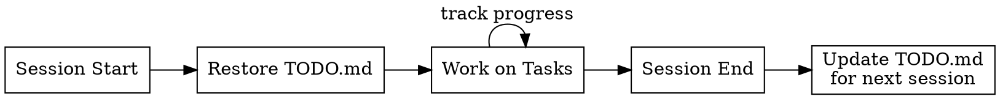

# Session Management

Full session lifecycle: START → DURING → END. Ensures continuity across Claude sessions.

## When to Use

- Starting a new Claude Code session (restore context)
- Completing a task mid-session (track progress)
- Ending a session or switching tasks (handoff state)
- Discovering new work that should persist across sessions

**Don't use for:** One-off questions, pure research, or conversations that don't produce actionable work items.

## Lifecycle Flow



## Two Tools, Two Purposes

| Tool | Scope | Use For |
|------|-------|---------|
| TaskCreate/TaskList | In-memory, resets each session | Breaking down current task into steps |
| TODO.md | Persistent file, survives forever | Cross-session continuity |

## START: Restore Context

1. Read TODO.md
2. Check git status for uncommitted changes
3. Roll "Done (This Session)" → "Done (Previous Sessions)" with date
4. Check for any `CONTINUE_HERE.md` files in the project (see below)
5. Announce current state to user
6. **Suggest ONE next action** — don't overwhelm with a list. Pick the single most logical next step based on priority and state.
7. After restoring context, consider routing through `orchestrate` skill for new tasks

**Output format:**
```
## Session Restored

### In Progress
[From TODO.md]

### Uncommitted Changes
[From git status - group by feature/area]

### Resume Point
[From CONTINUE_HERE.md if found, otherwise skip]

### Suggested Next Step
[ONE specific action — the single most important thing to do right now]
```

## DURING: Track Progress

**Use TaskCreate** for breaking down work into steps (in-session only)

**Update TODO.md** when:
- Starting a new item → move to "In Progress"
- Completing an item → move to "Done (This Session)" with outcome note
- Discovering new work → add to "Up Next"

## END: Session Handoff

Before session ends:
1. Move completed items to "Done (This Session)"
2. Update "In Progress" to reflect actual state
3. If paused mid-task: `- [ ] Task name (PAUSED: reason)`

## TODO.md Format

```markdown
# TODO

## In Progress
- [ ] Current task (max 1-2 items)

## Up Next
- [ ] Queued task

## Done (This Session)
- [x] Completed task - outcome note

## Done (Previous Sessions)
- [x] 2025-02-04: Task - outcome
```

## CONTINUE_HERE.md Pattern

When you're interrupted mid-task (context running low, user needs to leave, switching to different work):

1. **Create `CONTINUE_HERE.md`** in the relevant directory (e.g., `docs/CONTINUE_HERE.md` or the feature directory)
2. Keep it under 50 lines. Include:

```markdown
# Continue Here

**Task:** [What you were doing]
**Phase:** [Where you stopped]
**Next Step:** [Exact next action to take]
**Key Files:** [Files being modified]
**Blockers:** [Anything blocking progress]
**Context:** [Any non-obvious context the next session needs]
```

3. On session start, search for `CONTINUE_HERE.md` files:
   ```
   Glob: **/CONTINUE_HERE.md
   ```
4. After restoring context from the file, **delete it** — it's a one-time resume point, not persistent state.

---

## Session-End Lesson Extraction

At the end of each session (from reflexion:memorize pattern), briefly assess:

1. **Did we discover a reusable pattern?** → Add to memory files
2. **Did we hit a recurring problem?** → Add to `investigate/references/common-errors.md`
3. **Did we learn something about the codebase?** → Update relevant skill references

Only extract lessons that are:
- Confirmed across multiple instances (not one-off)
- Actionable (not just observations)
- Not already documented

Don't force it — most sessions won't produce extractable lessons, and that's fine.

---

## Red Flags

- Multiple "In Progress" items without active work
- No outcome notes on completed items
- TaskCreate used all session but TODO.md never updated
- CONTINUE_HERE.md files left from previous sessions (stale resume points)
