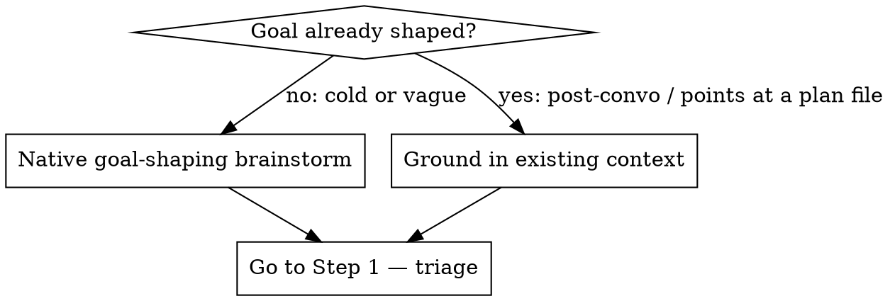

# Goal Creator

Turn a piece of work into a single, well-formed Claude Code `/goal` condition — or tell the user plainly when goal mode is the wrong tool.

`/goal <condition>` makes Claude keep working turn after turn, unprompted, until a **small fast model (Haiku by default) confirms the condition holds**, then auto-clears. Setting the goal starts a turn immediately with the condition as the directive. It pairs with **auto mode** (auto mode removes per-tool prompts; `/goal` removes per-turn prompts). Requires Claude Code **v2.1.139+**.

## How /goal works — the parts that constrain the condition

- **The evaluator only sees the transcript.** It does **not** run commands, read files, or inspect tool internals. It judges the condition against what Claude has *printed into the conversation*. → completion must be demonstrable in Claude's own output.
- **It cannot ask the user anything.** A goal runs unattended. Work that needs the user's decisions, taste, or inputs mid-run is impossible — the run will stall or fabricate placeholders/menus instead. (This is the #1 failure mode.) Corollary: **never put an AskUserQuestion / approval gate inside the condition** — push those to the human follow-up.
- **It runs until the condition is met or the bound is hit.** No turn/time cap = it can run forever.
- **One goal per session.** Multi-phase work = run one goal, review, then create the next (this skill writes one at a time).
- **Cross-repo by default.** A single goal run can read and modify more than one repo (e.g. Thoven FE + BE) — useful for full-stack end states and for referencing `TESTING.md` in both repos. Every repo it touches is still subject to the side-effect gate (Test 4).
- **Condition ≤ 4,000 characters.** Status: `/goal` (no arg). Stop early: `/goal clear`.

## Process — do these steps in order

### Step 0 — Front door: shape first, then ground in context

Before triage, decide whether the work is already shaped:



**Ground in existing context (when shaped).** This skill is usually invoked *after* a brainstorm. Mine the in-session conversation and any referenced plan/brainstorm file FIRST; carry those decisions into the condition and **do not re-ask what they already settled**. Quick targeted search only to resolve a *specific* vagueness (e.g. confirm the real test command) — never a full repo recon. If the goal will anchor on a plan/brainstorm file, record its path; the condition references it.

**Native goal-shaping brainstorm (when cold/vague).** Do NOT hand to `superpowers:brainstorming` — that explores product/feature intent, not goal levers. Walk the user through the goal levers in order, one or two at a time, to converge on a shapeable goal. It MAY read the user's own skills to grab domain/workflow context that shapes the goal — as reference. (Optionally land a short plan/brainstorm file the goal then references, or enter plan mode if a full design pass is wanted.)

> end state → proof → guidance/tools → skills/subagents → testing scope → progress → bound

These are the same levers used in Step 2.

**Discover what's available — don't assume a fixed toolset.** This skill is user-scoped: it runs across many repos and domains (code, research, ops, ads, writing). Check the session's available skills + subagents and the repo's own conventions (CLAUDE.md, `.claude/`, test/docs files), then pull in only those matching the goal's **domain** — a non-coding goal draws on entirely different skills than a coding one. Two exclusions: don't pull in skills outside the goal's area, and a goal whose job *is* an activity must NOT invoke that activity's skill (a code-review goal doesn't call the code-review skill; coding-only machinery like a thermo-nuclear/quality pass belongs only on code/implementation goals).

### Step 1 — Fit triage (GATE — do this BEFORE writing anything)

A goal is appropriate **only when ALL five hold**. State your check on each:

| Test | Passes when | Fails when |
|---|---|---|
| **1. Verifiable end state** | "done" is an objective fact: a test passes, a file exists with stated contents, a queue is empty, a count is reached, a build exits 0 | "done" is taste/quality ("good", "polished", "compelling") |
| **2. Autonomous to completion** | Claude can finish with its own tools, with **zero** decisions or inputs from the user mid-run | the work needs the user to choose an option, supply a number, or approve a direction partway |
| **3. Provable in the transcript** | completion shows up in what Claude prints (paths + outlines, test output, counts) | the proof lives only in a file/console the evaluator can't see |
| **4. Side effects gated** | the goal stops at a safe state (draft / paused / dry-run / PR-opened) before any irreversible step | the goal would spend money, deploy, send messages, or delete autonomously |
| **5. Bounded** | there's a turn or time cap | open-ended |

**If any test fails, STOP. Do not write the goal.** Name the failing test and route to the right tool:

- Needs the user's decisions/inputs → **interactive session** (or the native Step 0 brainstorm), not a goal.
- Subjective "done" / quality bar → convert into an **objective proxy** via a relevant skill's checklist/rubric (e.g. a design skill's adherence checklist) — then it IS goal-able; otherwise **interactive iteration** or an **LLM-judge rubric** (`write-judge-prompt`).
- Recurring on a schedule → **`/loop`** or a scheduled routine, not a one-shot goal.
- Needs a custom deterministic gate → a **Stop hook**.

> Hard-won lesson: a goal whose end state is "produce options for the user to choose from" always comes back as un-decided menus. Decisions cannot live inside a goal. Split the decision out into an interactive step *first*, then write a goal for the autonomous work that follows.

### Step 2 — Clarifying questions + levers (ask 2–4; one batch is fine)

Ask only what Step 0 did NOT already establish. Core fields:

- **End state** — the single measurable thing that means done.
- **Proof** — how Claude demonstrates it *in the transcript* (print the path + section outline, paste the test output, state the count).
- **Constraints** — what must NOT change; boundaries that matter.
- **Bound** — max turns or time.
- **Safe gate** — for any risky step, the line to stop before.

Then the levers that make a goal strong — pull each into the condition when it applies:

| Lever | Ask | Fills condition slot |
|---|---|---|
| **Guidance** | where to start, which command/tool, which files | "starting in X, using Y" |
| **Skills + subagents** | from what THIS repo/session offers (don't assume a fixed set), which available **skills** should the goal USE — *driven* in auto mode, and/or as *reference* (design system, checklist, conventions, workflow steps) — and which **specialized subagents** should it dispatch to structure the workflow? Pick by the goal's domain. | "driving `<skill>` in auto mode / dispatching `<role>` subagents per task + a verifier / using `<skill>`'s checklist as proof" |
| **Testing scope** | allowed to run a **live E2E**? **create dummy/test data**? **read production**? (anchor on the repo's own testing docs/conventions if present) | constraints: "may create test data; do NOT read prod; run E2E via `<cmd>`" |
| **Output + measurement** | proof shape; for ambitious goals, build a measurement tool (diff/eval) to track progress | proof clause + optional "build and use `<tool>`" |
| **Visual guardrail** | for visual work, what **non-pixel** proxy proves done (feature checklist, design-system adherence)? | proof = checklist, NOT "pixel-perfect" |
| **Progress** | log to a work file the run appends to after each update? | "append status to `<slug>-progress.md` after each update and print it here" |
| **Finalize / quality** | *(code/implementation goals only)* run the repo's cleanup/quality pass before stopping? | see Step 4 (gate at non-trivial Major) |

Lean toward referencing whatever skills/subagents fit the **domain** — a goal that names the right ones inherits proven workflow structure for free, and parallel subagents do more per turn. (A coding goal might name a design skill + per-task implementer subagents + a reviewer; a research goal might name source-gathering + a fact-check subagent.) **Driving a skill/agent that normally asks the user:** run it in **auto mode** and either pre-lock its decisions in the condition or have the goal **dispatch an advisor subagent** to stand in for the human input — the goal itself can't ask (Step 1.2).

### Step 3 — Write the condition

Parts of a condition (bracketed levers are optional):

1. **Directive + measurable end state** — what to do and what "done" objectively is.
2. **Stated check / proof** — how it's proven, surfaced into the transcript.
3. **[Guidance]** — start in `<area>`, use `<command/tool>`, [invoke `<skill/agent>`].
4. **Constraints** — what must hold / not change [+ testing scope].
5. **[Progress]** — append status to `<slug>-progress.md` after each update and print it here.
6. **Bound** — `or stop after N turns and report what is blocking`.

Template:

```
/goal <do X to reach end state Y>[, starting in <area> using <tool/skill>]; the goal is met only when <objective, transcript-verifiable proof> with <constraints / testing scope>[; append progress to <slug>-progress.md after each update]; otherwise stop after <N> turns and report what is blocking.
```

Rules: keep ≤ 4,000 chars; phrase so the **transcript alone** proves it; for file outputs require the **path(s) + section outline printed into chat** (the evaluator can't open the file); for risky work bake the **stop-at-gate** into the condition; **never put an approval gate inside the condition** — goals can't ask (Step 1.2). Worked good/bad rewrites: `references/condition-patterns.md`.

### Step 4 — Emit + save

1. Print the ready-to-paste `/goal …` block in chat.
2. Print a **mini-runbook**: turn on **auto mode** for an unattended run; **one goal per session**; check status with `/goal`, stop with `/goal clear`; watch `<slug>-progress.md` during a long run; if the work is multi-phase, run this goal → review → create the next; needs **v2.1.139+**.
3. **Finalize / quality loop — code/implementation goals ONLY.** If (and only if) the goal produces or changes code, bake into the condition that it runs the repo's code-quality pass (for this user: `/simplify` + `thermo-nuclear-code-quality-review`) and resolves **Critical + trivial** findings, then **stops with non-trivial Major findings reported** (it can't get approval mid-run). Then tell the user the human follow-up in the runbook: re-run that pass and loop with **AskUserQuestion approval gates** until Critical + non-trivial Major are cleared. **Non-code goals skip this** — use a domain-appropriate finalize if any (e.g. a citation/fact-check pass for research), or none. Never use draft-PR / commit-cadence checkpoints.
4. **Save a goal-spec file** from `assets/goal-spec-template.md` to `goal-specs/<slug>.md` in the current working directory (offer a different location if a project folder fits better). Fill in the triage results, the anchor, the condition, guidance, testing scope, progress file, finalize loop, runbook, and rationale. Tell the user the path.

## Red flags — you're about to write a bad goal

- "…produce options / a menu / recommendations for the user to pick" → needs decisions → **not a goal** (Step 1.2).
- "…make it high-quality / polished / compelling" with no objective check → subjective → **not a goal** (Step 1.1).
- "…the file/doc is correct/complete" → evaluator can't read it → rewrite as "section outline printed in chat" (Step 1.3).
- "…create and launch / deploy / send / charge" → ungated irreversible → **stop at draft/paused** (Step 1.4).
- no `stop after N turns` clause → can run forever (Step 1.5).
- "…make it pixel-perfect to this image" → visual rabbit-hole → drive the relevant design skill and prove via its **design-system-adherence + element checklist** (a non-pixel proxy), not pixel-matching (Step 2).
- hardcoding tools/skills/subagents the goal's domain doesn't use, or forcing a code-quality pass onto a non-code goal → you skipped domain-fit discovery (Step 0).
- re-asking something the conversation/plan already settled → you skipped Step 0 grounding.
- an **AskUserQuestion / approval gate inside the condition** → goals can't ask → move it to the human follow-up (Step 1.2, Step 4).
